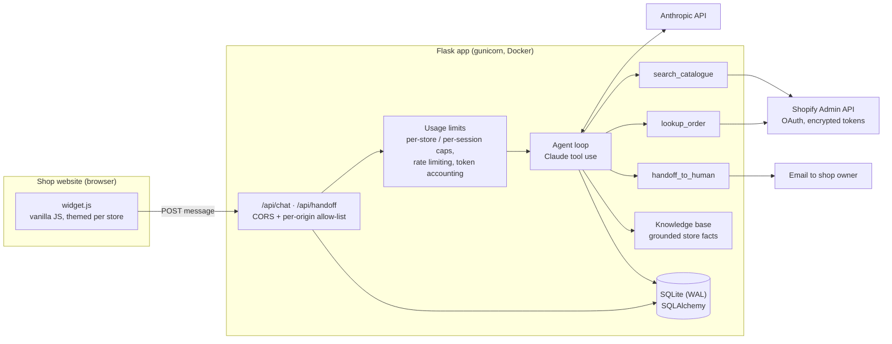

# Tillbird — AI customer support agent for online shops

Tillbird is an AI support assistant that sits on a shop's website as a chat
widget. It answers customer questions about order status, returns, shipping,
sizing and products, using the shop's own policies and live product
catalogue. When it can't help, it hands the conversation to a human with the
full transcript.

It runs in production for UK online shops at
[tillbird.co.uk](https://tillbird.co.uk). Live demo:
[app.tillbird.co.uk/demo/demo-outreach-devonwick](https://app.tillbird.co.uk/demo/demo-outreach-devonwick).

> **Showcase repository.** This is a trimmed public copy of a private
> production codebase. Sales and lead-generation tooling, deployment configs
> and all client data have been removed. The core agent, Shopify integration,
> onboarding pipeline and their test suites are included.

## Architecture



**One request, end to end:**

1. A customer types in the widget. `widget.js` POSTs to `/api/chat` with the
   store id and the session.
2. The route checks the origin against the store's allow-list and applies the
   per-store and per-session usage caps.
3. The agent loop (`app/agent/loop.py`) builds a store-specific system prompt
   from `stores/<id>.yaml` and the grounded knowledge base, then runs Claude
   with tools.
4. Tools call the Shopify Admin API for live products and orders. Order
   lookups require a matching email, so a customer can never see another
   customer's data.
5. If the agent can't answer, `handoff_to_human` emails the shop owner the
   transcript and the customer's contact details.
6. Every turn is logged with its token cost, which feeds monthly per-store
   reports.

## Key engineering decisions

- **Grounded onboarding instead of free-form generation.** New stores are
  onboarded by scraping their policy, FAQ, care and size-guide pages. Claude
  drafts a knowledge base, and every drafted fact is checked against its
  source text (`app/kb_grounding.py`) before it is used. Unverifiable facts
  are dropped rather than guessed.
- **Guardrails tested as code.** Prompt-injection attempts, invented
  discounts, other customers' data and off-topic requests are covered by an
  adversarial eval of ~40 scripted customer messages (`app/evaluation.py`,
  `scripts/eval.py`).
- **Cost control as a first-class feature.** Hard caps per store and per
  session, token accounting per call, and rate limiting, so one abusive
  visitor can't run up an API bill.
- **Security.** Shopify access tokens are encrypted at rest
  (`app/credential_encryption.py`). CORS uses per-store origin allow-lists,
  and the widget has no third-party dependencies.
- **Offline test suite.** 620+ pytest tests run with no network: the
  Anthropic client is replaced by a fake (`tests/fake_anthropic.py`) and all
  Shopify and HTTP calls are stubbed.

## Project layout

| Path | What it is |
|---|---|
| `app/agent/` | Agent loop, tools, system prompt, order lookup, handoff |
| `app/routes/` | HTTP API: chat, handoff, widget, Shopify OAuth, health |
| `app/static/widget.js` | Embeddable chat widget (~850 lines, vanilla JS) |
| `app/shopify_client.py`, `app/shopify_oauth.py` | Shopify Admin API client and OAuth install flow |
| `app/scraping.py`, `app/demo_kb.py`, `app/kb_grounding.py` | Store scraping, knowledge-base drafting, fact grounding |
| `app/usage_limits.py`, `app/anthropic_usage.py` | Caps, rate limiting, token accounting |
| `app/reporting.py`, `app/evaluation.py` | Monthly reports, adversarial eval |
| `stores/*.yaml` | One config file per client store |
| `scripts/` | CLI tools: provision a store, build a demo, run evals, ask the agent |
| `tests/` | 620+ offline tests |

## Stack

Python 3.12 · Flask · SQLAlchemy (SQLite, WAL mode) · Anthropic API (tool use) ·
Shopify Admin API (OAuth) · BeautifulSoup · vanilla JavaScript · Docker ·
gunicorn · Caddy · pytest

## Running locally

```bash
cp .env.example .env          # add ANTHROPIC_API_KEY at minimum
pip install -r requirements-dev.txt
python scripts/init_db.py
flask --app wsgi run --port 8000
```

Or with Docker:

```bash
docker compose up --build
```

Ask the agent a question from the terminal, using the example store:

```bash
python scripts/ask_agent.py demo-example "Do you ship to Ireland?"
```

## Tests

```bash
pytest -q
```

## Author

Built and run by **Lev Manzhai**: design, back end, front-end widget,
Shopify integration, deployment and operations.
[LinkedIn](https://www.linkedin.com/in/lev-manzhai-a3168a395)

## License

All rights reserved. Shared for portfolio and review purposes only.
